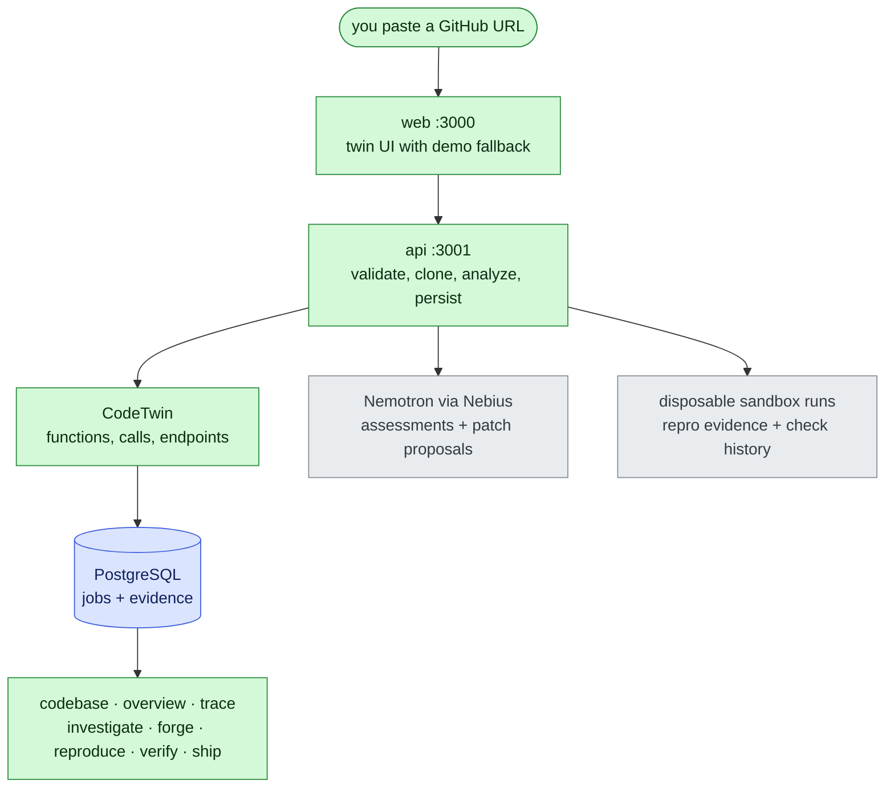

# HUBRIS

**Confidence, earned.** An AI software-engineering system that builds a living
model of a codebase — mapping architecture, tracing execution, investigating
failures with an NVIDIA reasoning model on Nebius infrastructure — and verifies
fixes before developers ship.

Built for the **Nebius x NVIDIA Global AI Hackathon**, track: **Coding and
Agentic Engineering**.

> **Status: working prototype.** Analysis, persistence, live code-twin UI,
> model-backed investigation and patch proposals, and sandbox-backed
> reproduce/verify are live. Full details in [docs/ARCHITECTURE.md](docs/ARCHITECTURE.md).

---

## How it works



> Legend: green = live HUBRIS components · blue = persisted state ·
> gray = external Nebius infrastructure. Full reference:
> [docs/ARCHITECTURE.md](docs/ARCHITECTURE.md).

HUBRIS never executes repository code during analysis — it parses it. Execution
happens only inside VM-isolated Contree sandboxes (see
[Nebius integration](#nebius-integration)).

## Prerequisites

- **Node.js** 24.19.0 (see `.nvmrc`)
- **pnpm** 10.34.5
- **Docker** (local PostgreSQL)
- A **Nebius** API key + project (model inference and sandboxes live)

## Setup

```bash
pnpm install --frozen-lockfile

cp .env.example .env
# fill in: GITHUB_TOKEN (optional), NEBIUS_API_KEY, NEBIUS_MODEL,
# NEBIUS_PROJECT_ID; DATABASE_URL already defaults to local Docker.

docker compose up -d postgres
pnpm --filter @hubris/db migrate
```

`apps/web/.env.local` is created for Next.js (`HUBRIS_API_BASE` /
`NEXT_PUBLIC_API_BASE`, defaulting to the API below).

## Run

```bash
pnpm --filter @hubris/api dev   # API → http://localhost:3001
pnpm --filter web dev           # frontend → http://localhost:3000
# or everything at once:
pnpm dev
```

Ports: web `3000`, API `3001`, PostgreSQL `5433` (a native Windows PostgreSQL
on `5432`, if present, is left untouched).

## Verify

```bash
pnpm typecheck   # turbo: builds workspace deps first, then typechecks
pnpm test        # vitest everywhere (DB tests run when DATABASE_URL is set,
                 # otherwise they skip; CI provides Postgres)
pnpm lint
pnpm build
```

Try it end to end (PowerShell):

```powershell
$body = @{ repoUrl = "https://github.com/ai/nanoid" } | ConvertTo-Json
Invoke-RestMethod -Method Post -Uri http://localhost:3001/api/analyze `
  -ContentType "application/json" -Body $body
# → { jobId, stats, sample }; open http://localhost:3000/codebase
```

## Architecture

```
hubris/
├── apps/
│   ├── web/                 Next.js 16 frontend (live twin UI + demo fallback)
│   └── api/                 Hono API: analyze, jobs, investigate, forge
├── services/
│   ├── analyzer/            TypeScript static analysis → twin graph
│   │                        (functions, classes, endpoints, tests, CALLS/IMPORTS
│   │                        with caller attribution,incl. route handlers)
│   ├── db/                  Drizzle + PostgreSQL (jobs store, migrations)
│   ├── llm/                 OpenAI-compatible chat client + twin prompts
│   └── sandbox/             ConTree sandbox REST client (live: disposable runs)
├── packages/
│   ├── config/ · types/     Shared stubs (reserved)
├── fixtures/
│   ├── demo-repo/           Tiny demo app used by docs/tests
│   └── deep-chain/          Adversarial trace fixture: branches, a cycle,
│                            externals, decoy endpoint (see trace suite)
├── docker-compose.yml       Local PostgreSQL 17
└── .github/workflows/ci.yml install → migrate → typecheck → test → build
```

### API reference

| Method | Route | Purpose |
| ------ | ----- | ------- |
| GET | `/health` | Liveness |
| GET | `/api/analyze?repo=owner/repo` | Public repo metadata (GitHub API) |
| POST | `/api/analyze` `{ repoUrl }` | Clone → analyze → persist job (`pending→complete/failed`) |
| GET | `/api/jobs?limit=&repoUrl=` | Latest-first job listing |
| GET | `/api/jobs/:id` | Persisted job incl. full twin |
| POST | `/api/investigate` `{ jobId, question? }` | Model assessment of a completed job |
| POST | `/api/forge` `{ jobId, focus?, instruction? }` | Patch + regression-test proposal (`verified: false`) |
| POST | `/api/checkout` `{ jobId, ref?, image? }` | Transfer job repo into a sandbox workspace (tarball upload + manifest verify) |
| POST | `/api/install` `{ jobId, ref?, image?, manager? }` | Install repo deps in a sandbox (`--ignore-scripts`, lockfile-honoring) |
| POST | `/api/run-tests` `{ jobId, ref?, image?, manager?, testCommand? }` | Run the repo's own test suite in an installed sandbox (exit 0 = PASS) |
| POST | `/api/regression` `{ jobId, testContent XOR generate, ... }` | Write a regression test into the workspace and execute the suite |
| POST | `/api/apply` `{ jobId, diff, ... }` | Apply a unified diff in the sandbox workspace, then run the suite |
| POST | `/api/forge-verify` `{ jobId, diff?/draft, ... }` | Forge → Apply → Verify lifecycle with explicit states (VERIFIED only on exit 0) |

### Page status

Live with demo fallback: `/codebase`, `/overview`, `/trace` (incl. entry
selector), `/investigate`, `/forge`. Demo narrative until sandbox lands:
`/reproduce`, `/verify`, `/ship`.

## Nebius integration

- **Inference (live):** `services/llm` calls an OpenAI-compatible chat API
  (`NEBIUS_BASE_URL`, key `NEBIUS_API_KEY`, model `NEBIUS_MODEL`) for
  investigation answers and patch proposals. Bounded prompts, capped tokens,
  failures surface as `502` — never silent.
- **Sandboxes (live):** `services/sandbox` implements the ConTree REST
  contract; `POST /api/reproduce` + `POST /api/verify` run disposable
  commands, `POST /api/checkout` transfers a job's repo (tracked-files
  tarball upload, sha256 + file-count verified) into a sandbox workspace,
  and `POST /api/install` installs its dependencies there — always with
  `--ignore-scripts`, honoring lockfiles. `POST /api/run-tests` executes the
  repo's own test command in the installed workspace (exit 0 = PASS), and
  `POST /api/regression` writes a caller-provided or Nemotron-drafted
  regression test into the workspace before running the suite, and
  `POST /api/apply` applies a caller-provided unified diff there first
  (real repo never touched) and runs the suite against it.
  `POST /api/forge-verify` runs the whole Forge → Apply → Verify lifecycle
  in one disposable sandbox, recording explicit states
  (PROPOSED → … → VERIFIED) and claiming VERIFIED only on exit 0. Exit codes, stdout/stderr, and
  manifests are stored as job evidence. Every run carries explicit
  timeout/wait/output caps (`HUBRIS_SANDBOX_*`, `HUBRIS_MAX_OUTPUT_BYTES`).

## NVIDIA usage

Reasoning throughout investigate/forge comes from the **Nemotron** family of
NVIDIA open-source models served via Nebius (`NEBIUS_MODEL`). The model only
ever sees twin summaries (function lists, endpoints, relationships) — never
credentials — and its output is labeled: assessments are opinions, patches are
`verified: false` proposals until sandbox verification exists.

## Roadmap

1. Forge-output parsing + autonomous patch choice (with verification states)
2. Sandbox-backed `/verify` of forged patches against real checkouts
2. Sandbox-backed `/verify` (apply proposal in sandbox, run tests, record)
3. `/ship` evidence bundle from verified jobs
4. Server-side trace endpoint (today traces compute client-side from job data)

## Demo

- Live demo: _TODO — paste URL_
- Demo video (≤ 3 min): _TODO — paste YouTube link_

## License

MIT — see [LICENSE](LICENSE).
