# HUBRIS Architecture

Canonical source of truth for how HUBRIS is built **today**. Every diagram
reflects the implementation in this repository — nothing here is aspirational.
Intended future work lives only in [15. Future Architecture](#15-future-architecture),
explicitly labeled.

Conventions: boxes marked `CURRENT` exist and run. Boxes marked `FUTURE` do
not exist yet. See [14. Current Limitations](#14-current-limitations).

## 1. System Overview

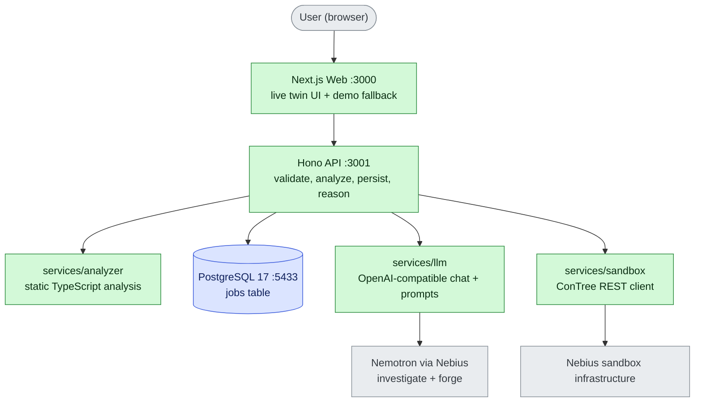

Dependency direction is strict: `apps/api` imports the four services.
Services never import each other or the apps (verified by import audit).

## 2. Monorepo Structure

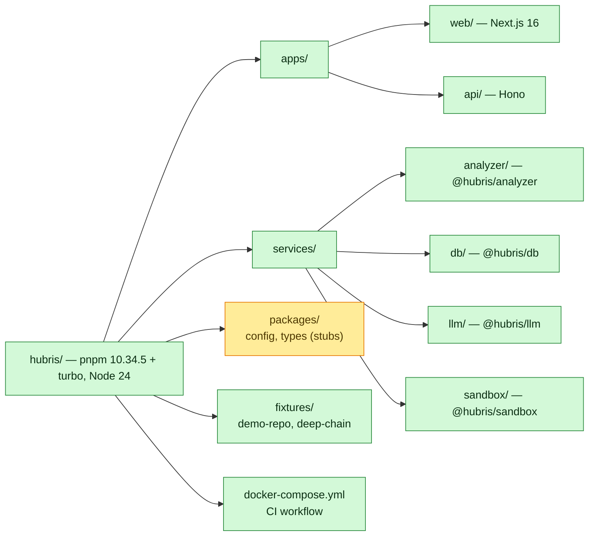

## 3. Dependency Direction

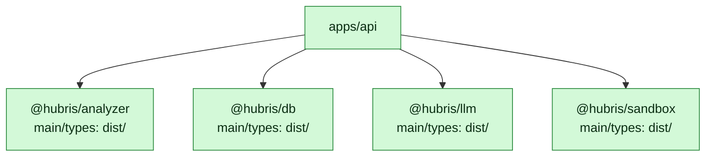

Workspace packages resolve through **compiled `dist` entrypoints**, which do
not exist on a fresh checkout. Therefore `turbo.json` declares
`dependsOn: ["^build"]` for `typecheck` and `test`, so declarations are
emitted before dependents consume them.

## 4. Repository Ingestion

Flow for `POST /api/analyze` with body `repoUrl`:

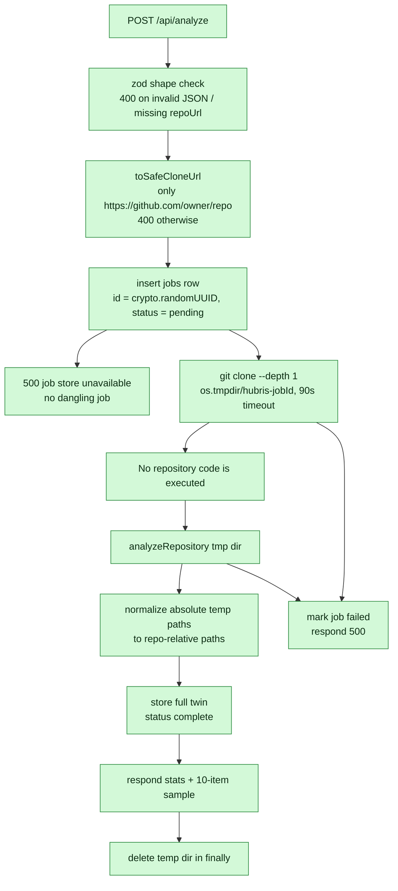

Ingestion vs persistence as a sequence. Note the deliberate split: the HTTP
response is slim, the database keeps everything.

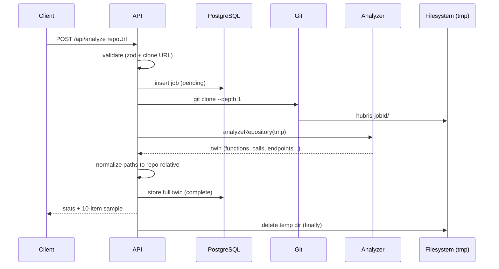

## 5. CodeTwin Analyzer

`services/analyzer`, TypeScript Compiler API over `.ts` / `.js` files
(`node_modules`, `dist`, `.git` and build output are skipped):

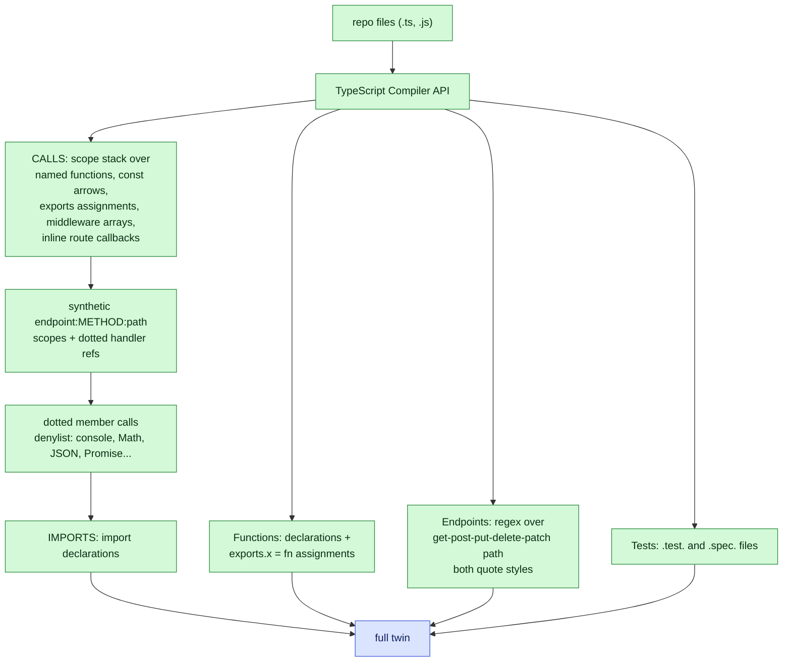

Known boundary: class/object-literal methods are not function nodes yet
(only their inner calls are tracked). `const X = () => …` arrows are
discovered since the arrow-discovery phase, with `outer.inner` qualification
for nested cases.

## 6. Data Model

Exact persisted structures. `jobs.result` is JSONB carrying the twin.

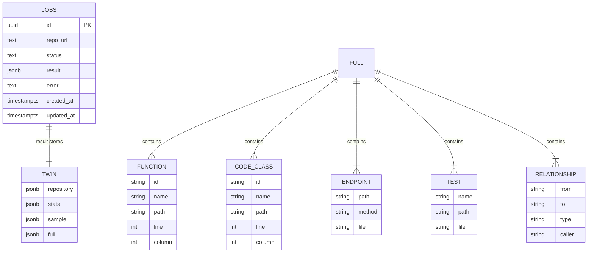

`status` is one of `pending`, `complete`, `failed`. Relationship `type` is
one of `CALLS`, `IMPORTS`, `DEFINES`, `TESTS`, `DEPENDS_ON`. `stats` holds
counts plus `analysisMs`. `sample` holds the first 10 functions and endpoints.
`reproductions` and `verifications` arrays accumulate on `result` as those
flows run.

## 7. Investigate

`POST /api/investigate` with body `jobId, question?`:

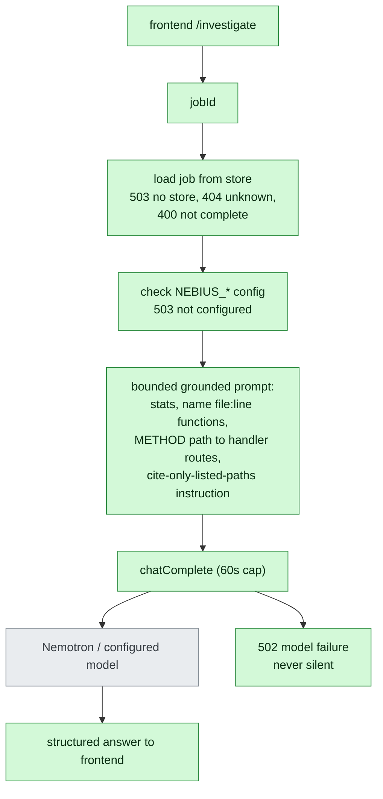

The answer is model analysis grounded in the stored twin. It is opinion, not
verified truth.

## 8. Forge

`POST /api/forge` with body `jobId, focus?, instruction?`:

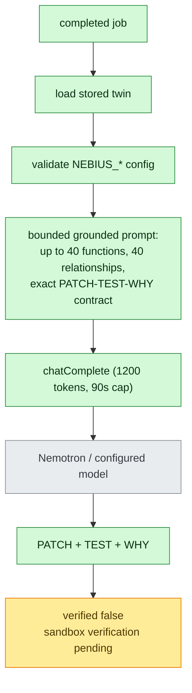

Forge output is a **proposal only**. Nothing is applied, and verification does
not exist yet (see section 9).

## 9. Sandbox Boundary

This section is deliberately honest about what runs where today.

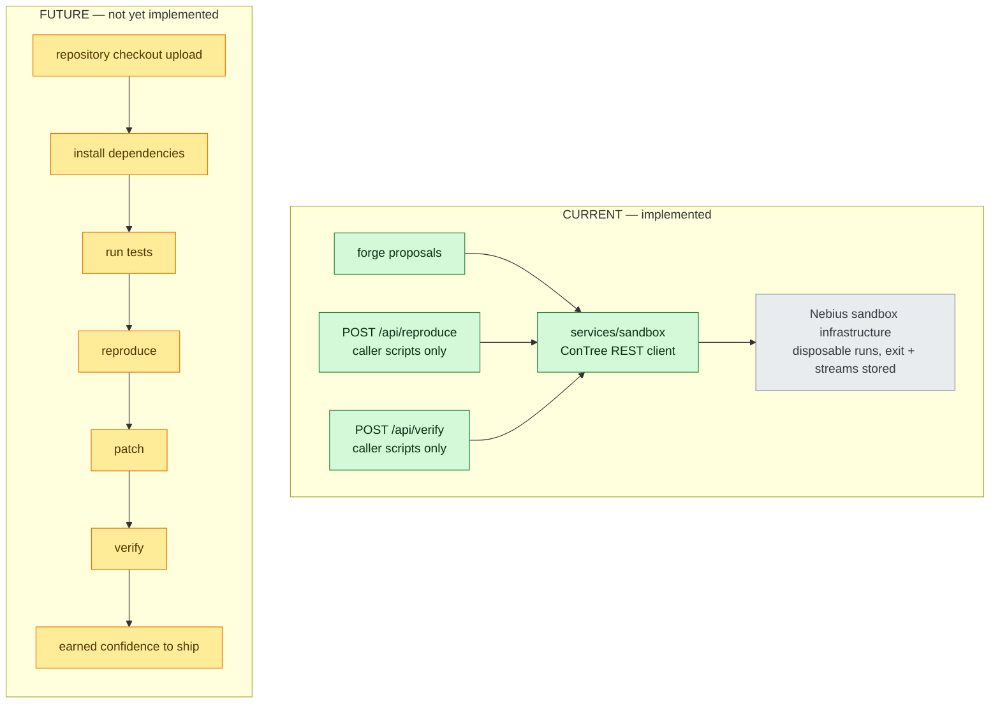

Repository code execution through an uploaded checkout is **not implemented**.
Reproduce/verify run caller-provided scripts in disposable sandboxes and store
exit code, stdout, stderr. No production writes exist anywhere.

## 10. Trace Engine

`traceFromTwin()` in `apps/web/app/lib/live-twin.ts`. **Client-side only —
no server-side trace endpoint exists.** Input is the `GET /api/jobs/:id`
payload.

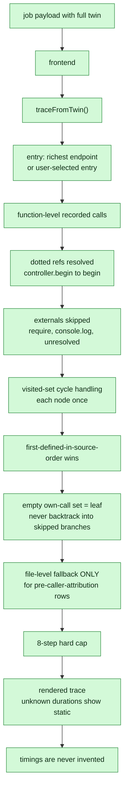

Proven adversarially: `fixtures/deep-chain` (branches, a cycle, externals, a
decoy endpoint) yields exactly the predicted 8 steps; suites pin extraction
facts, traversal rules, and the engine-to-API contract.

## 11. Frontend

Next.js 16. Every workspace page follows one pattern:

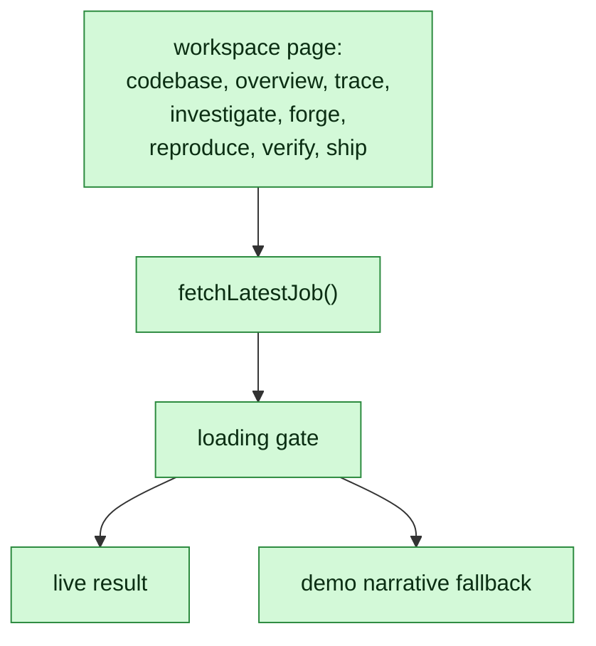

All browser API traffic goes through Next proxy routes. The browser never
touches the Hono API directly:

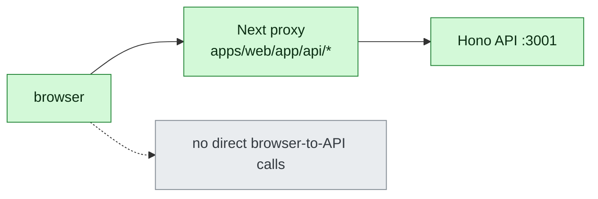

Proxy routes exist for `analyze`, `jobs`, `jobs/[id]`, `investigate`,
`forge`, `reproduce`, `verify`.

## 12. Runtime / Infrastructure

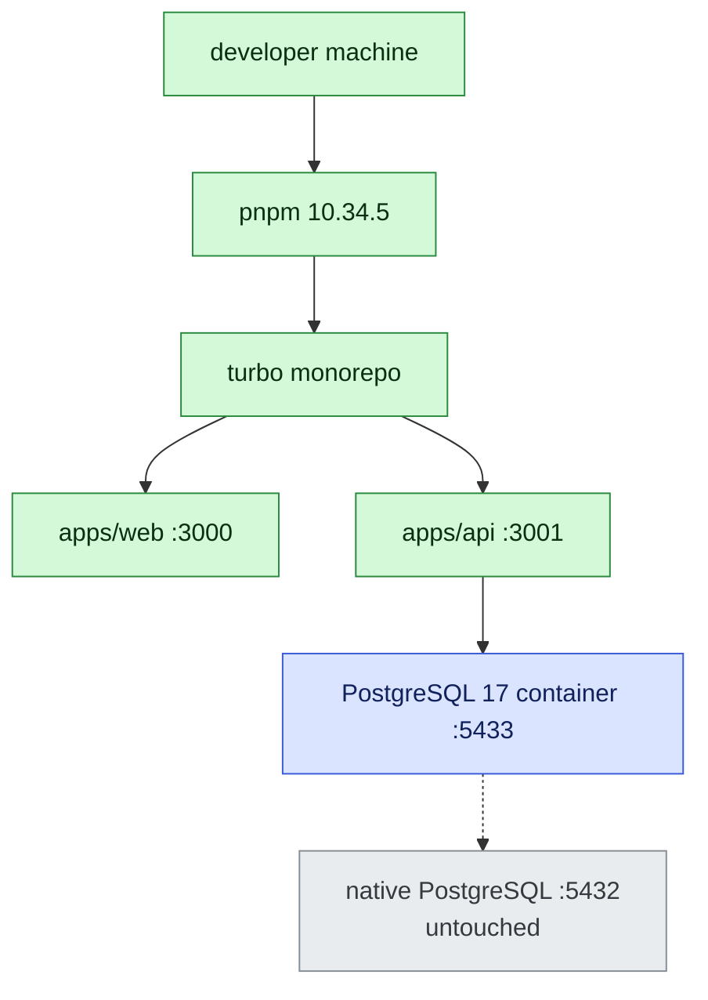

Build order (why `dependsOn: ["^build"]`):

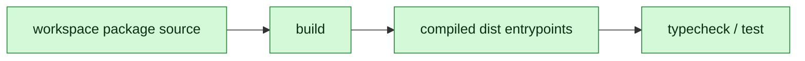

## 13. CI

`.github/workflows/ci.yml` on push and pull request:

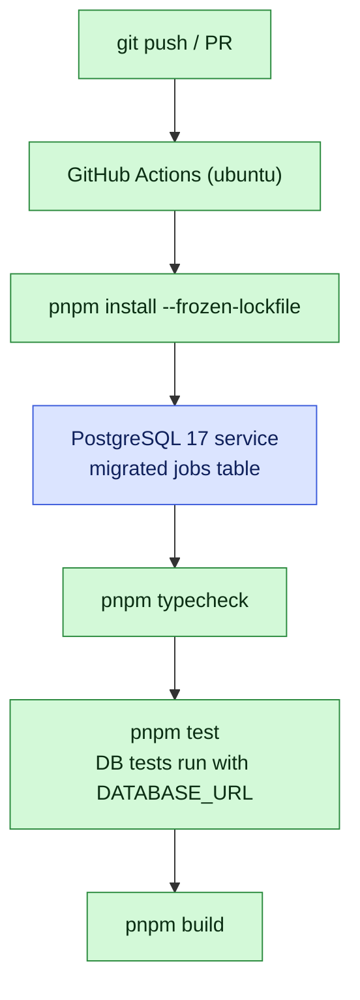

Locally, DB-backed tests skip when `DATABASE_URL` is unset.

## 14. Current Limitations

Explicit and complete as of this writing. Each item is a tracked engineering
task, not a permanent verdict — the arrow-function limitation previously
listed here was fixed the same way:

- Sandbox **repository execution** (uploaded checkout, install, test) is not
  implemented; reproduce/verify run caller scripts only.
- **No server-side trace endpoint**; traces compute client-side from job data.
- **Method discovery** is incomplete: class and object-literal methods are not
  function nodes yet (their inner calls are tracked).
- **Model output is unverified**: investigation is opinion, forge output is
  labeled `verified: false`.
- Analyzer parses **TypeScript/JavaScript only**; other languages complete
  with empty twins.
- `packages/config` and `packages/types` are reserved stubs.

## 15. Future Architecture

Labeled FUTURE. None of this exists yet:

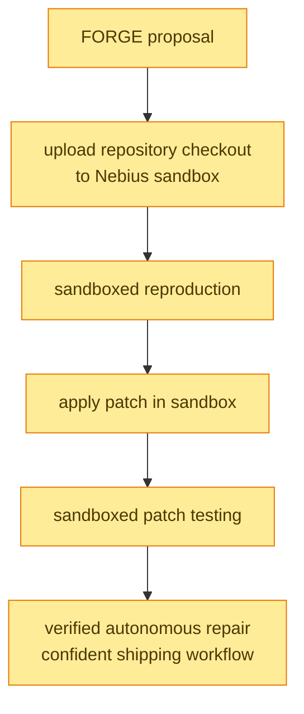

Entry criteria for each step: live verification against the implementation,
the same standard this document holds throughout.
